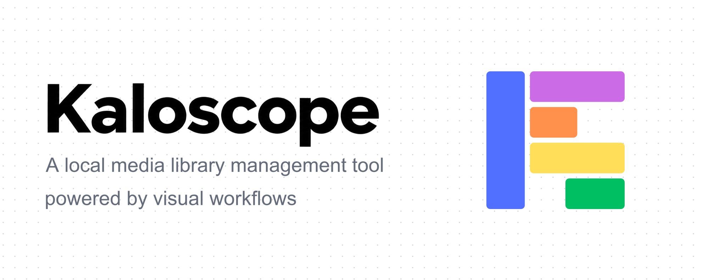
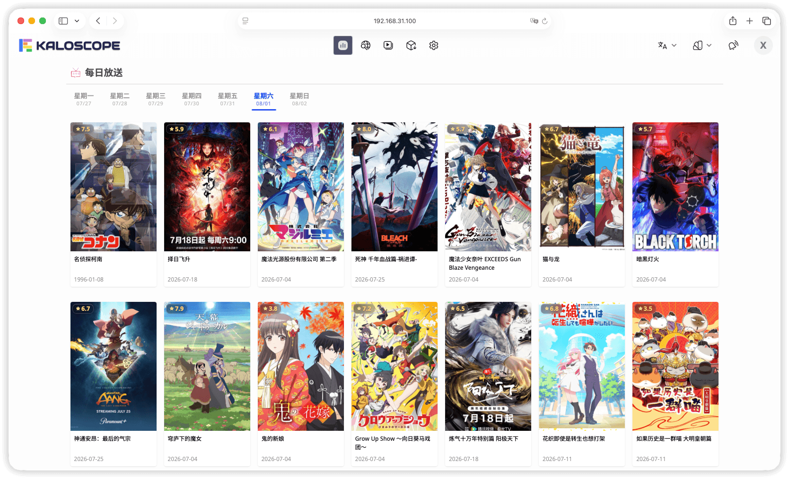

<div align="right">

📖 **English** | [简体中文](README.md)

</div>

<div align="center">


[](https://github.com/kaloscope/kaloscope/releases)
[](https://github.com/kaloscope/kaloscope/stargazers)
[](https://hub.docker.com/r/kaloscope/kaloscope)
[](https://xyflow.com/)
[](https://svelte.dev/)
[](https://sanic.dev/)
[](https://www.python.org/)
[](LICENSE)
[![Ask DeepWiki](https://img.shields.io/badge/Ask-DeepWiki-blue.svg?logo=data:image/png;base64,iVBORw0KGgoAAAANSUhEUgAAACwAAAAyCAYAAAAnWDnqAAAAAXNSR0IArs4c6QAAA05JREFUaEPtmUtyEzEQhtWTQyQLHNak2AB7ZnyXZMEjXMGeK/AIi+QuHrMnbChYY7MIh8g01fJoopFb0uhhEqqcbWTp06/uv1saEDv4O3n3dV60RfP947Mm9/SQc0ICFQgzfc4CYZoTPAswgSJCCUJUnAAoRHOAUOcATwbmVLWdGoH//PB8mnKqScAhsD0kYP3j/Yt5LPQe2KvcXmGvRHcDnpxfL2zOYJ1mFwrryWTz0advv1Ut4CJgf5uhDuDj5eUcAUoahrdY/56ebRWeraTjMt/00Sh3UDtjgHtQNHwcRGOC98BJEAEymycmYcWwOprTgcB6VZ5JK5TAJ+fXGLBm3FDAmn6oPPjR4rKCAoJCal2eAiQp2x0vxTPB3ALO2CRkwmDy5WohzBDwSEFKRwPbknEggCPB/imwrycgxX2NzoMCHhPkDwqYMr9tRcP5qNrMZHkVnOjRMWwLCcr8ohBVb1OMjxLwGCvjTikrsBOiA6fNyCrm8V1rP93iVPpwaE+gO0SsWmPiXB+jikdf6SizrT5qKasx5j8ABbHpFTx+vFXp9EnYQmLx02h1QTTrl6eDqxLnGjporxl3NL3agEvXdT0WmEost648sQOYAeJS9Q7bfUVoMGnjo4AZdUMQku50McDcMWcBPvr0SzbTAFDfvJqwLzgxwATnCgnp4wDl6Aa+Ax283gghmj+vj7feE2KBBRMW3FzOpLOADl0Isb5587h/U4gGvkt5v60Z1VLG8BhYjbzRwyQZemwAd6cCR5/XFWLYZRIMpX39AR0tjaGGiGzLVyhse5C9RKC6ai42ppWPKiBagOvaYk8lO7DajerabOZP46Lby5wKjw1HCRx7p9sVMOWGzb/vA1hwiWc6jm3MvQDTogQkiqIhJV0nBQBTU+3okKCFDy9WwferkHjtxib7t3xIUQtHxnIwtx4mpg26/HfwVNVDb4oI9RHmx5WGelRVlrtiw43zboCLaxv46AZeB3IlTkwouebTr1y2NjSpHz68WNFjHvupy3q8TFn3Hos2IAk4Ju5dCo8B3wP7VPr/FGaKiG+T+v+TQqIrOqMTL1VdWV1DdmcbO8KXBz6esmYWYKPwDL5b5FA1a0hwapHiom0r/cKaoqr+27/XcrS5UwSMbQAAAABJRU5ErkJggg==&style=flat-square)](https://deepwiki.com/kaloscope/kaloscope)
[](https://t.me/kaloscope_official)

[Documentation](https://kaloscope.org/docs/introduction)
|
[Deployment Guide](https://kaloscope.org/docs/deployment)
|
[FAQ](https://kaloscope.org/docs/faq)
|
[Contributing](https://kaloscope.org/docs/development)
|
[Workflow Templates](https://github.com/kaloscope/workflows)
|
[Telegram Group](https://t.me/kaloscope_official)



</div>

## Overview

Kaloscope is a local media library manager that combines an **AI assistant** with **visual workflows**, bringing resource search, downloads, metadata scraping, ingestion, and playback together.

v1.0.0 brings AI into workflow creation and everyday media management. Describe what you need, review changes on the canvas, or edit nodes directly to control each step.

## AI Features

### :speech_balloon: Built-in AI Assistant

- Use the current page and execution logs to inspect workflows, media, and download status and troubleshoot issues
- Create and edit indexers, movie and TV scrapers, and other workflows through conversation, with validation, trial runs, and repairs
- Watch changes appear on the node canvas, then save the draft or revert them; you decide when to publish
- Manage download tasks and plans, workflow schedules, library scans, rescraping, and ingestion settings through conversation

Download, schedule, plan, and media changes are previewed for confirmation before they run. Available actions follow your account permissions.

### :robot: AI Workflow Nodes

- Add model calls to workflows, using context variables for text processing, information extraction, and other tasks
- Return text or structured JSON, with JSON Schema validation for structured results
- Configure cloud and local models in one place through OpenAI-compatible APIs, including DeepSeek, Gemini, Ollama, and LM Studio

### :link: External AI Clients

Connect through [MCP](#mcp-access) to inspect media and tasks, edit workflow drafts, and manage downloads from your preferred AI client, without deploying a separate bridge service.

## Features

|  |  |  |  |
| ------------------------------------------------------------- | ------------------------------------------------------------- | -------------------------------------------------------- | --------------------------------------------------------- |

### :wrench: Visual Workflows

- Build workflows by dragging and connecting nodes for HTTP requests, Python scripts, conditions, loops, and more
- Adapt search and scraping to resource sites and metadata sources through editable workflows
- Import community templates from GitHub and automate execution with schedules

### :mag: Search and Downloads

- Search by keyword, preview details, and authenticate with indexers; global search combines results from multiple sources
- Connect [`aria2`](https://aria2.github.io/), [`qBittorrent`](https://www.qbittorrent.org/), [`Transmission`](https://transmissionbt.com/), and other downloaders, or use [`OpenList`](https://github.com/OpenListTeam/OpenList) for cloud downloads and transfer results to local storage
- Automate downloads with keyword and filter rules, or add magnet links and torrent files manually

### :clapper: Media Libraries

- Manage movie, TV, and other libraries with real-time file monitoring to discover new media
- Use workflows for metadata scraping and ingestion, with custom naming and organization rules
- Read and write NFO metadata and preview video, image, and text resources online

### :arrow_forward: Playback

- Play FLV, HLS, and MP4 with the built-in player and real-time transcoding on demand
- Use hardware acceleration such as NVENC, VAAPI, and VideoToolbox, with configurable output quality limits
- Enjoy danmaku, playback progress tracking, resume, and a mobile-friendly full-screen mode

### :iphone: Users and Devices

- Separate administrator and user roles, with access permissions for individual libraries and indexers
- Set personal preferences, switch themes, and install the app on desktop or mobile as a PWA

## Quick Start

Deploy with Docker, replacing the UID, GID, and host directories to match your environment:

```bash
docker run -d \
  --name kaloscope \
  --add-host=host.docker.internal:host-gateway \
  -e PUID=1026 \
  -e PGID=100 \
  -e TZ=Asia/Shanghai \
  -e ENABLE_ARIA2=true \
  -v /volume1/kaloscope/workspace:/workspace \
  -v /volume1/kaloscope/downloads:/downloads \
  -v /volume1/kaloscope/media:/media \
  -p 8000:8000 \
  -p 6888:6888 \
  -p 6888:6888/udp \
  --restart unless-stopped \
  kaloscope/kaloscope:latest
```

Open `http://<server-ip>:8000` and follow the setup page to create an administrator account. Use container paths when configuring downloaders and libraries:

| Container path | Purpose                                                     |
| -------------- | ----------------------------------------------------------- |
| `/workspace`   | Database and application settings; must be persisted        |
| `/downloads`   | Downloaded files                                            |
| `/media`       | Media library files; mount additional directories as needed |

This example enables the built-in aria2 service. For an external downloader, remove `ENABLE_ARIA2` and the `6888` port mappings. See the [Deployment Guide](https://kaloscope.org/docs/deployment) for HTTPS, hardware transcoding, and other options.

### Enable AI

1. As an administrator, open **System → Model Providers**, add a service, enter its API URL and any required key, and select or enter model IDs
2. Open the assistant from the top navigation bar and select a model to start chatting
3. Add an AI node to a workflow to process workflow data with a configured model

The assistant requires a model that supports tool calling. Local model services must be reachable from the container. Other media management features work without AI configuration.

## MCP Access

Create a token under **Personal → Access Tokens**, then enter these settings in an MCP client that supports Streamable HTTP and Bearer authentication:

| Setting              | Value                                                                                        |
| -------------------- | -------------------------------------------------------------------------------------------- |
| Transport            | `Streamable HTTP`                                                                            |
| MCP URL              | `http://127.0.0.1:8000/_api/mcp`, replaced with an instance address reachable by your client |
| Authorization header | `Authorization: Bearer <token>`, replacing `<token>` with the full token                     |

Tokens default to read-only access. Choose read-write access to edit drafts, run workflow trials, or apply changes; account permissions still apply. The full token is shown only once at creation. If your client has a **Bearer Token** field, enter only the token itself.

## Star History

[](https://www.star-history.com/?repos=kaloscope%2Fkaloscope&type=date&legend=top-left)

## Contributors

Thank you to everyone who has contributed code, documentation, feedback, and ideas to the project.

[](https://github.com/kaloscope/kaloscope/graphs/contributors)

## Acknowledgements

- **Dandanplay Open Platform**

  Thanks to the [`Dandanplay Open Platform`](https://doc.dandanplay.com/open/) for providing the danmaku service API.

- **Third-Party Dependencies and Open Source Communities**

  This project is built on many excellent open source projects. We thank all developers and contributors for their continued work. See [`LICENSES`](LICENSES.md) for the complete list of third-party dependencies and their licenses.

## Related Links

- [TV Client](https://github.com/kaloscope/android-tv)
- [Community Workflow Templates](https://github.com/kaloscope/workflows)
- [Dandanplay API Proxy Service](https://github.com/kaloscope/danmaku)
- [LINUX DO](https://linux.do)

## Disclaimer

- This project is intended solely for personal learning and technical exchange. Commercial use and the distribution of illegal content are prohibited
- Community or third-party workflows may contain arbitrary code or network requests; users are responsible for reviewing and verifying their security and legality
- Users bear all legal liabilities, risks, and losses arising from the use of this project; the developers assume no joint and several liability

## License

This project is released under the [`GPLv3`](LICENSE) open source license.
