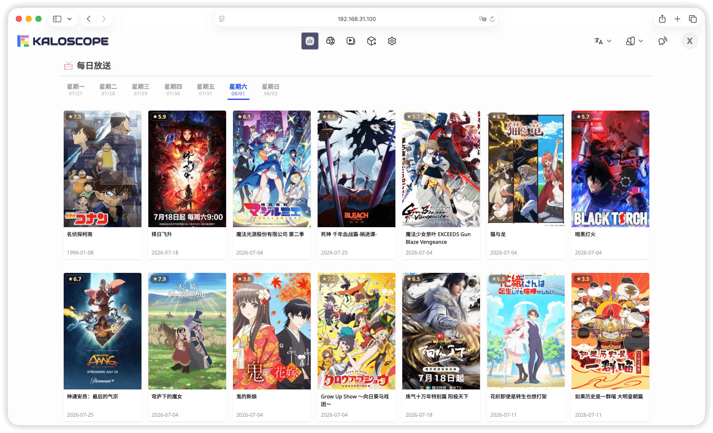

<div align="right">

📖 **简体中文** | [English](README.en-US.md)

</div>

<div align="center">


[](https://github.com/kaloscope/kaloscope/releases)
[](https://github.com/kaloscope/kaloscope/stargazers)
[](https://hub.docker.com/r/kaloscope/kaloscope)
[](https://xyflow.com/)
[](https://svelte.dev/)
[](https://sanic.dev/)
[](https://www.python.org/)
[](LICENSE)
[![Ask DeepWiki](https://img.shields.io/badge/Ask-DeepWiki-blue.svg?logo=&style=flat-square)](https://deepwiki.com/kaloscope/kaloscope)
[](https://t.me/kaloscope_official)

[演示站点](https://demo.kaloscope.org/login?username=kaloscope&password=kaloscope)
|
[使用文档](https://kaloscope.org/docs/introduction)
|
[部署指南](https://kaloscope.org/docs/deployment)
|
[常见问题](https://kaloscope.org/docs/faq)
|
[参与开发](https://kaloscope.org/docs/development)
|
[工作流模板](https://github.com/kaloscope/workflows)
|
[TG 群组](https://t.me/kaloscope_official)



</div>

## 项目简介

Kaloscope 是一款基于可视化工作流引擎的本地媒体库管理工具。其资源搜索与元数据刮削等能力均由可编辑的工作流来驱动，可灵活对接任意资源站点与元数据来源。

## 快速开始

通过 Docker 命令行直接拉取并运行单个 Kaloscope 容器的示例：

```bash
docker run -d \
  --name kaloscope \
  --add-host=host.docker.internal:host-gateway \
  -e PUID=1026 \
  -e PGID=100 \
  -e UMASK=022 \
  -e TZ=Asia/Shanghai \
  -e AUTO_TLS=true \
  -e TLS_HOSTNAME=192.168.31.2 \
  -e ENABLE_ARIA2=true \
  -v /volume1/kaloscope/workspace:/workspace \
  -v /volume1/kaloscope/downloads:/downloads \
  -v /volume1/kaloscope/anime:/anime \
  -p 8000:8000 \
  -p 6888:6888 \
  -p 6888:6888/udp \
  --restart unless-stopped \
  kaloscope/kaloscope:latest
```

上例中各参数说明如下：

**环境变量（`-e`）**

| 变量名         | 默认值  | 说明                                                                                                          |
| -------------- | ------- | ------------------------------------------------------------------------------------------------------------- |
| `PUID`         | `0`     | 进程运行 UID，NAS 环境建议设为媒体目录所有者                                                                  |
| `PGID`         | `0`     | 进程运行 GID，NAS 环境建议设为媒体目录所属用户组                                                              |
| `UMASK`        | `022`   | 文件创建掩码，影响容器内新建文件的默认权限                                                                    |
| `TZ`           | 无      | 容器时区，如 `Asia/Shanghai`、`UTC` 等                                                                        |
| `AUTO_TLS`     | `false` | 使用 [`mkcert`](https://github.com/FiloSottile/mkcert) 自动签发本地 TLS 证书，适合需要局域网 HTTPS 访问的用户 |
| `TLS_HOSTNAME` | 无      | 指定 TLS 证书绑定的主机名或 IP，仅 `AUTO_TLS=true` 时生效                                                     |
| `ENABLE_ARIA2` | `false` | 在容器内启动内置的 aria2 服务，适合不想单独部署下载器的用户                                                   |

**端口映射（`-p`）**

| 端口   | 协议    | 说明                                                          |
| ------ | ------- | ------------------------------------------------------------- |
| `8000` | TCP     | Kaloscope Web UI 访问端口                                     |
| `6888` | TCP/UDP | aria2 DHT 与 BT 监听端口（仅 `ENABLE_ARIA2=true` 时需要映射） |

**数据卷（`-v`）**

| 容器内路径   | 必要性 | 说明                                     |
| ------------ | ------ | ---------------------------------------- |
| `/workspace` | 必须   | 持久化存储目录，保证容器重启后数据不丢失 |

> [!NOTE]
> 更多详细配置说明请参考[`部署指南`](https://kaloscope.org/docs/deployment)。

## 功能特性

|  |  |  |  |
| ------------------------------------------------------------- | ------------------------------------------------------------- | -------------------------------------------------------- | --------------------------------------------------------- |

### :wrench: 工作流

- 提供基于节点的可视化工作流编辑器，拖拽即可搭建业务流程
- 内置 HTTP 请求、Python 脚本、条件分支、循环控制等节点类型
- 支持从 GitHub 仓库导入社区工作流模板，快速复用已有方案
- 支持定时触发，可按计划自动执行工作流

### :mag: 资源搜索

- 索引器完全由工作流驱动，可对接任意资源站点
- 支持关键词搜索、详情预览、登录认证等完整交互流程
- 支持全局搜索，可同时聚合多个索引器的结果
- 视频、图片、文字等资源类型支持在线预览

### :inbox_tray: 下载管理

- 支持 [`aria2`](https://aria2.github.io/)、[`qBittorrent`](https://www.qbittorrent.org/)、[`Transmission`](https://transmissionbt.com/) 等下载器
- 支持将 [`OpenList`](https://github.com/OpenListTeam/OpenList) 的网盘离线下载工具固定为下载器，并把远端结果直拉到本地
- 下载器配置通过 YAML 定义，可按需扩展适配器
- 支持下载计划，可按关键词和过滤规则自动抓取并下发下载任务
- 支持手动添加磁力链接或种子文件

### :clapper: 媒体库管理

- 支持电影、电视剧等多种媒体库类型
- 支持实时监控文件系统，自动识别新加入的媒体文件
- 支持生成和解析 [`NFO`](https://en.wikipedia.org/wiki/.nfo) 文件并同步媒体元数据

### :arrow_forward: 在线播放

- 内置视频播放器，支持 FLV、HLS、MP4 格式
- 支持实时转码播放，按需将视频转为 HLS 流，可按画质限制输出
- 支持多种硬件加速编码（NVENC、VAAPI、VideoToolbox 等）
- 支持弹幕显示与移动端样式全屏播放
- 支持记录播放进度和续播

### :busts_in_silhouette: 用户权限

- 支持多用户，并区分管理员与普通用户角色
- 可按媒体库和索引器分配访问权限
- 支持个人偏好设置与头像自定义

### :iphone: PWA 支持

- 支持以 [`PWA`](https://web.dev/explore/progressive-web-apps) 方式安装到桌面或移动设备
- PWA 主题颜色可随应用内主题同步切换

## 只读 MCP 接入

Codex 等 MCP 客户端可以通过 Streamable HTTP 直接连接 Kaloscope，查询工作流、媒体库、媒体详情、
下载进度、定时任务及模型配置。入口为 `/_api/mcp`，使用 Kaloscope 现有端口，不需要客户端安装 Python、
检出源码或启动桥接进程。MCP 复用现有业务服务、登录会话和工作流权限，不提供编辑、发布或执行工具。

在 Codex 配置中添加：

```toml
[mcp_servers.kaloscope]
url = "http://127.0.0.1:8000/_api/mcp"
bearer_token_env_var = "KALOSCOPE_TOKEN"
```

将地址替换为实际的 Kaloscope 实例地址。通过现有登录接口 `POST /_api/auth/login` 获取响应中的
`data.token`，在启动 Codex 的环境中设置 `KALOSCOPE_TOKEN`。令牌不放入工具参数或项目文件；
会话过期或退出登录后，需要重新登录并更新令牌。远程连接建议使用 HTTPS。
其它支持 Streamable HTTP 的 MCP 客户端使用相同地址，并通过 `Authorization: Bearer <token>` 认证。

| 工具                   | 用途                                                                 |
| ---------------------- | -------------------------------------------------------------------- |
| `list_workflows`       | 按名称、分类和状态分页读取有权限访问的工作流                         |
| `get_workflow`         | 读取指定工作流的元数据、草稿和已发布定义                             |
| `list_node_types`      | 读取节点字段、默认值、约束和连接点，支持按分类或节点类型过滤         |
| `get_workflow_logs`    | 读取工作流最近保留的运行日志，不触发执行                             |
| `list_workflow_jobs`   | 按工作流名称、状态和触发方式查询有权限访问的定时任务                 |
| `list_media_libraries` | 读取有权限访问的媒体库及当前扫描状态，不触发扫描                     |
| `list_media_items`     | 按标题或文件名、媒体库分页检索已入库媒体，支持查询已有条目的精确路径 |
| `get_media_item`       | 读取媒体详情、可见子条目和当前元数据异常，不播放或重新索引           |
| `list_download_tasks`  | 查询已保存的下载状态、进度和错误摘要，不主动刷新下载器               |
| `list_ai_providers`    | 管理员查看提供商状态和已配置模型，不返回 API Key 或调用模型          |

分页工具每页最多返回 100 项。媒体和定时任务遵循对应媒体库、工作流的访问权限；下载任务沿用下载页面的
共享可见范围，不返回源链接、文件列表或下载器凭据。提供商列表包含已禁用的配置，便于排查 AI 节点配置失效。

连接后可以让 Codex 分析失败工作流的日志、核对 AI 节点与提供商配置、查找已入库媒体，或汇总下载失败的任务。
所有工具均为只读，不包含编辑、发布、执行、下载、扫描或模型推理操作。

## 星标历史

[](https://www.star-history.com/?repos=kaloscope%2Fkaloscope&type=date&legend=top-left)

## 贡献者

感谢所有为本项目提交代码、文档、反馈和建议的贡献者。

[](https://github.com/kaloscope/kaloscope/graphs/contributors)

## 特别鸣谢

- **弹弹play开放平台**

  感谢 [`弹弹play开放平台`](https://doc.dandanplay.com/open/) 提供的弹幕服务接口支持。

- **第三方依赖与开源社区**

  本项目构建在众多优秀的开源项目之上，感谢所有开发者与贡献者的持续投入。完整的第三方依赖列表及对应开源协议见 [`LICENSES`](LICENSES.md) 文件。

## 相关链接

- [TV 客户端](https://github.com/kaloscope/android-tv)
- [社区工作流模板](https://github.com/kaloscope/workflows)
- [弹弹play API 代理服务](https://github.com/kaloscope/danmaku)
- [LINUX DO](https://linux.do)

## 免责声明

- 本项目仅供个人学习与技术交流使用，禁止用于商业目的或传播违法内容
- 社区或第三方工作流可能包含任意代码或网络请求，使用者需自行审查验证其安全性与合法性
- 因使用本项目引发的一切法律责任、风险与损失，均由使用者自行承担，开发者不承担任何连带责任

## 开源协议

本项目基于 [`GPLv3`](LICENSE) 开源协议发布。
