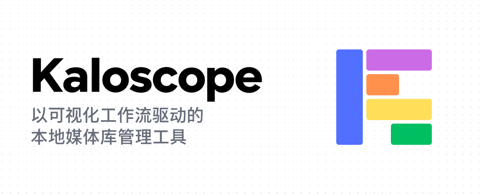
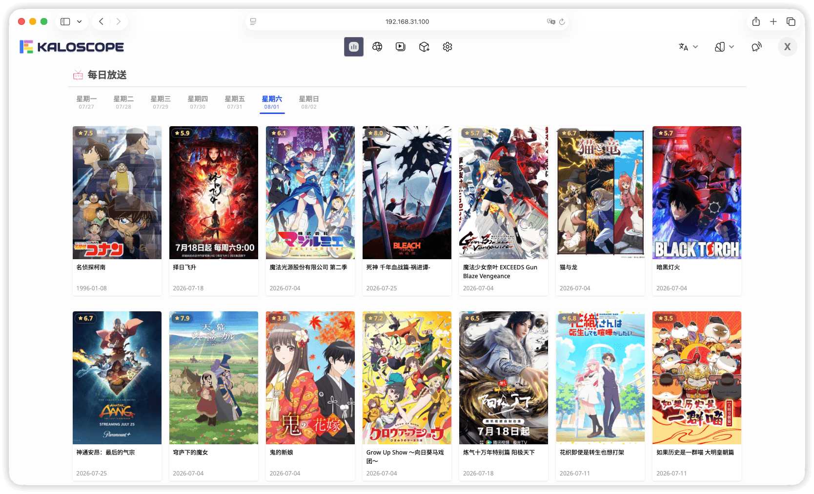

<div align="right">

📖 **简体中文** | [English](README.en-US.md)

</div>

<div align="center">


[](https://github.com/kaloscope/kaloscope/releases)
[](https://github.com/kaloscope/kaloscope/stargazers)
[](https://hub.docker.com/r/kaloscope/kaloscope)
[](https://xyflow.com/)
[](https://svelte.dev/)
[](https://sanic.dev/)
[](https://www.python.org/)
[](LICENSE)
[![Ask DeepWiki](https://img.shields.io/badge/Ask-DeepWiki-blue.svg?logo=&style=flat-square)](https://deepwiki.com/kaloscope/kaloscope)
[](https://t.me/kaloscope_official)

[使用文档](https://kaloscope.org/docs/introduction)
|
[部署指南](https://kaloscope.org/docs/deployment)
|
[常见问题](https://kaloscope.org/docs/faq)
|
[参与开发](https://kaloscope.org/docs/development)
|
[工作流模板](https://github.com/kaloscope/workflows)
|
[TG 群组](https://t.me/kaloscope_official)



</div>

## 项目简介

Kaloscope 是一款结合 **AI 助手** 与 **可视化工作流** 的本地媒体库管理工具，串联资源搜索、下载、元数据刮削、入库与在线播放。

v1.0.0 将 AI 带入工作流编排与日常媒体管理：用自然语言描述需求，在画布上查看修改，也可以直接编辑节点，掌控每一步处理逻辑。

## AI 功能

### :speech_balloon: 内置 AI 助手

- 结合当前页面与运行日志，查询工作流、媒体和下载状态，协助定位问题
- 用自然语言搭建和修改索引器、影视刮削等工作流，支持校验、试运行与修复
- 修改实时呈现在节点画布上，可保存为草稿或撤回，工作流发布仍由你决定
- 通过对话管理下载任务与计划、工作流定时任务，以及影视库扫描、重新刮削和入库设置

下载、计划与媒体变更会先展示预览，确认后再执行；可用操作受当前账号权限限制。

### :robot: AI 工作流节点

- 将模型调用接入工作流，利用上下文变量完成文本处理、信息提取等任务
- 支持文本与结构化 JSON 输出，并通过 JSON Schema 校验结构化结果
- 统一配置云端与本地模型，支持 OpenAI 兼容接口，可连接 DeepSeek、Gemini、Ollama、LM Studio 等服务

### :link: MCP 外部接入

通过 [MCP](#mcp-接入) 连接外部 AI 客户端，在熟悉的对话工具中查询媒体与任务、编辑工作流草稿和管理下载，无需额外部署桥接服务。

## 功能特性

|  |  |  |  |
| ------------------------------------------------------------- | ------------------------------------------------------------- | -------------------------------------------------------- | --------------------------------------------------------- |

### :wrench: 可视化工作流

- 拖拽节点搭建业务流程，内置 HTTP 请求、Python 脚本、条件分支、循环控制等节点
- 通过可编辑的工作流对接资源站点和元数据来源，按需扩展搜索与刮削能力
- 支持从 GitHub 导入社区模板，并通过定时任务自动执行工作流

### :mag: 搜索与下载

- 支持关键词搜索、详情预览与登录认证，全局搜索可聚合多个索引器的结果
- 对接 [`aria2`](https://aria2.github.io/)、[`qBittorrent`](https://www.qbittorrent.org/)、[`Transmission`](https://transmissionbt.com/) 等下载器，也可通过 [`OpenList`](https://github.com/OpenListTeam/OpenList) 离线下载并拉取到本地
- 按关键词与过滤规则创建自动下载计划，也可手动添加磁力链接或种子文件

### :clapper: 媒体库管理

- 支持电影、电视剧等媒体库，实时监控文件变化并发现新增媒体
- 通过工作流完成元数据刮削与入库，支持自定义命名和整理规则
- 支持 NFO 元数据读写，以及视频、图片、文字等资源的在线预览

### :arrow_forward: 在线播放

- 内置播放器，支持 FLV、HLS、MP4 与按需实时转码
- 支持 NVENC、VAAPI、VideoToolbox 等硬件加速，可限制转码输出画质
- 支持弹幕、播放进度记录、断点续播与移动端样式全屏播放

### :iphone: 多用户与多端访问

- 区分管理员与普通用户，可按媒体库和索引器分配访问权限
- 支持个人偏好、主题切换，并可作为 PWA 安装到桌面或移动设备

## 快速开始

使用 Docker 部署，按实际环境替换 UID、GID 和宿主机目录：

```bash
docker run -d \
  --name kaloscope \
  --add-host=host.docker.internal:host-gateway \
  -e PUID=1026 \
  -e PGID=100 \
  -e TZ=Asia/Shanghai \
  -e ENABLE_ARIA2=true \
  -v /volume1/kaloscope/workspace:/workspace \
  -v /volume1/kaloscope/downloads:/downloads \
  -v /volume1/kaloscope/media:/media \
  -p 8000:8000 \
  -p 6888:6888 \
  -p 6888:6888/udp \
  --restart unless-stopped \
  kaloscope/kaloscope:latest
```

启动后访问 `http://<服务器 IP>:8000`，按页面提示创建管理员账号。配置下载器和媒体库时，使用容器内的路径：

| 容器路径     | 用途                             |
| ------------ | -------------------------------- |
| `/workspace` | 保存数据库与应用配置，必须持久化 |
| `/downloads` | 下载文件目录                     |
| `/media`     | 媒体库目录，可按需挂载多个       |

示例启用了内置 aria2；使用外部下载器时，可移除 `ENABLE_ARIA2` 和 `6888` 端口映射。HTTPS、硬件转码等配置见[部署指南](https://kaloscope.org/docs/deployment)。

### 启用 AI

1. 管理员在「系统设置 → 模型提供商」添加服务，填写 API 地址和所需密钥，选择或手动填写模型
2. 打开顶部导航栏的助手，选择模型，即可开始对话
3. 在工作流中添加 AI 节点，可复用已配置的模型处理流程数据

助手需要支持工具调用的模型。本地模型服务需使用容器可访问的地址；未配置 AI 时，其余媒体管理功能仍可正常使用。

## MCP 接入

在「个人设置 → 访问令牌」创建令牌，将以下信息填入支持 Streamable HTTP 与 Bearer 认证的 MCP 客户端：

| 配置项     | 值                                                             |
| ---------- | -------------------------------------------------------------- |
| 传输协议   | `Streamable HTTP`                                              |
| MCP 地址   | `http://127.0.0.1:8000/_api/mcp`，替换为客户端可访问的实例地址 |
| 认证请求头 | `Authorization: Bearer <token>`，将 `<token>` 替换为完整令牌   |

令牌默认只读，编辑草稿、试运行或应用变更需选择读写权限；账号权限仍然生效。完整令牌仅在创建时显示一次；若客户端提供 **Bearer Token** 输入框，只填写令牌本身。

## 星标历史

[](https://www.star-history.com/?repos=kaloscope%2Fkaloscope&type=date&legend=top-left)

## 贡献者

感谢所有为本项目提交代码、文档、反馈和建议的贡献者。

[](https://github.com/kaloscope/kaloscope/graphs/contributors)

## 特别鸣谢

- **弹弹play开放平台**

  感谢 [`弹弹play开放平台`](https://doc.dandanplay.com/open/) 提供的弹幕服务接口支持。

- **第三方依赖与开源社区**

  本项目构建在众多优秀的开源项目之上，感谢所有开发者与贡献者的持续投入。完整的第三方依赖列表及对应开源协议见 [`LICENSES`](LICENSES.md) 文件。

## 相关链接

- [TV 客户端](https://github.com/kaloscope/android-tv)
- [社区工作流模板](https://github.com/kaloscope/workflows)
- [弹弹play API 代理服务](https://github.com/kaloscope/danmaku)
- [LINUX DO](https://linux.do)

## 免责声明

- 本项目仅供个人学习与技术交流使用，禁止用于商业目的或传播违法内容
- 社区或第三方工作流可能包含任意代码或网络请求，使用者需自行审查验证其安全性与合法性
- 因使用本项目引发的一切法律责任、风险与损失，均由使用者自行承担，开发者不承担任何连带责任

## 开源协议

本项目基于 [`GPLv3`](LICENSE) 开源协议发布。
